```mermaid
classDiagram
    direction TB

    %% ==================================================
    %% COMPOSITION ROOT
    %% ==================================================

    class MauiProgram {
        <<composition root>>
    }

    class App {
        <<application>>
    }

    class AchievementServiceCollectionExtensions {
        <<extension>>
    }

    note for MauiProgram "Registers services, managers, checkers and page ViewModels in the DI container"
    note for App "Takes IRewardManager in the constructor, so the container creates it at startup and it starts listening to events"
    note for AchievementServiceCollectionExtensions "Collects all IAchievementChecker implementations via reflection"

    MauiProgram ..> AchievementServiceCollectionExtensions : calls
    AchievementServiceCollectionExtensions ..> IAchievementChecker : registers via reflection


    %% ==================================================
    %% PRESENTATION (MVVM)
    %% ==================================================

    class AppShell {
        <<navigation>>
    }

    class Views {
        <<view>>
        +Pages
        +Components
        +Overlays
    }

    class PageViewModels["Page ViewModels"] {
        <<viewmodel>>
        MainMenuViewModel
        GameModesViewModel
        AchievementsViewModel
        ThemeSelectionViewModel
        ProfilePageViewModel
        SettingsViewModel
        HowToViewModel
        LangSelectViewModel
    }

    class ItemViewModels["Item ViewModels"] {
        <<viewmodel>>
        HowToCardViewModel
        ModeStatViewModel
        PurchaseThemeOverlayViewModel
        ThemeItemViewModel
        ThemePreviewTileViewModel
        ThemePreviewViewModel
    }

    class GameViewModel {
        <<viewmodel>>
    }

    class TileViewModel {
        <<viewmodel>>
    }

    class ActionInputQueue {
        <<input buffer>>
    }

    AppShell ..> Views : navigates
    Views ..> PageViewModels : data binding
    Views ..> GameViewModel : data binding, events
    PageViewModels *-- ItemViewModels : item models
    GameViewModel *-- TileViewModel : tiles
    GameViewModel *-- ActionInputQueue : owns

    MauiProgram ..> PageViewModels : registers


    %% ==================================================
    %% SERVICES
    %% ==================================================

    class IProfileManager {
        <<interface>>
    }

    class ProfileManager

    class IStatisticsManager {
        <<interface>>
    }

    class StatisticsManager

    class IRewardManager {
        <<interface>>
    }

    class RewardManager {
        <<event-driven>>
    }

    note for RewardManager "Coin rewards: 25 (every 5 themes or 5 losses), 50 (every 5 wins), 100 (achievement unlocked)"

    class ISettingsManager {
        <<interface>>
    }

    class SettingsManager

    class OtherServiceInterfaces["Other service interfaces"] {
        <<interface>>
        IStoreManager
        IGameModeService
        IHowToService
    }

    class OtherServices["Other services"] {
        <<implementation>>
        StoreManager
        GameModeService
        HowToService
    }

    IProfileManager <|.. ProfileManager
    IStatisticsManager <|.. StatisticsManager
    IRewardManager <|.. RewardManager
    ISettingsManager <|.. SettingsManager
    OtherServiceInterfaces <|.. OtherServices

    App ..> IRewardManager : injected, starts listening
    App ..> IProfileManager : uses (DI)
    App ..> ISettingsManager : uses (DI)
    RewardManager ..> IProfileManager : subscribes to ThemeUnlocked, StatisticsUpdated, EarnCoins()
    RewardManager ..> IAchievementManager : subscribes to AchievementUnlocked

    GameViewModel ..> IProfileManager : uses (DI)
    GameViewModel ..> IStatisticsManager : uses (DI)
    PageViewModels ..> IProfileManager : uses (DI)
    PageViewModels ..> IStatisticsManager : uses (DI)
    PageViewModels ..> ISettingsManager : uses (DI)
    PageViewModels ..> OtherServiceInterfaces : uses (DI)

    MauiProgram ..> ProfileManager : registers
    MauiProgram ..> StatisticsManager : registers
    MauiProgram ..> RewardManager : registers
    MauiProgram ..> SettingsManager : registers
    MauiProgram ..> OtherServices : registers


    %% ==================================================
    %% PERSISTENCE
    %% ==================================================

    class PlayerProfile {
        <<model>>
        +string Name
        +int Coins
        +PlayerStatistics GlobalPlayerStatistics
        +HashSet~GameTheme~ UnlockedThemes
        +HashSet~AchievementType~ Achievements
        +Dictionary~GameModeType,int~ BestScores
        +Dictionary~GameModeType,GameSessionSave~ Saves
    }

    class PlayerStatistics {
        <<model>>
    }

    class GameSessionSave {
        <<model>>
        +LastState
        +History
        +MaxTileValue
    }

    class ISaveService {
        <<interface>>
    }

    class SaveService

    class Preferences {
        <<MAUI storage>>
        theme
        language
    }

    class ProfileJsonFiles["JSON files"] {
        <<storage>>
        PlayerProfile
        backups
    }

    ProfileManager *-- PlayerProfile : holds CurrentProfile
    PlayerProfile *-- PlayerStatistics
    PlayerProfile "1" *-- "0..*" GameSessionSave : per game mode
    ProfileManager ..> ISaveService : uses (DI)
    ISaveService <|.. SaveService
    SaveService ..> ProfileJsonFiles : profile + backups
    SettingsManager ..> Preferences : light settings
    MauiProgram ..> SaveService : registers


    %% ==================================================
    %% ACHIEVEMENTS
    %% ==================================================

    class IAchievementManager {
        <<interface>>
    }

    class AchievementManager

    class AchievementDataParser {
        <<parser>>
    }

    class IAchievementChecker {
        <<interface>>
    }

    class IGlobalAchievementChecker {
        <<interface>>
    }

    class ISessionAchievementChecker {
        <<interface>>
    }

    class ISpecialAchievementChecker {
        <<interface>>
    }

    class AchievementCheckers {
        <<checkers>>
        35 classes
    }

    IAchievementManager <|.. AchievementManager
    AchievementManager ..> IProfileManager : uses (DI)
    AchievementManager ..> AchievementDataParser : uses
    AchievementManager ..> IGlobalAchievementChecker : List
    AchievementManager ..> ISessionAchievementChecker : List
    AchievementManager ..> ISpecialAchievementChecker : List
    IAchievementChecker <|-- IGlobalAchievementChecker
    IAchievementChecker <|-- ISessionAchievementChecker
    IAchievementChecker <|-- ISpecialAchievementChecker
    IGlobalAchievementChecker <|.. AchievementCheckers
    ISessionAchievementChecker <|.. AchievementCheckers
    ISpecialAchievementChecker <|.. AchievementCheckers
    GameViewModel ..> IAchievementManager : checks, listens to unlocks
    PageViewModels ..> IAchievementManager : uses (DI)
    MauiProgram ..> AchievementManager : registers


    %% ==================================================
    %% THEMING
    %% ==================================================

    class IThemesManager {
        <<interface>>
    }

    class ThemesManager
    class ThemeRegistry

    class IThemeResource {
        <<interface>>
    }

    class ThemeResourceKeys {
        <<constants>>
    }

    class ThemeDictionaries {
        <<ResourceDictionary>>
        25 themes
    }

    IThemesManager <|.. ThemesManager
    ThemesManager ..> ThemeRegistry : uses
    ThemeRegistry o-- ThemeDictionaries : holds instances
    IThemeResource <|.. ThemeDictionaries
    ThemeDictionaries ..> ThemeResourceKeys : defines keys
    PageViewModels ..> IThemesManager : uses (DI)
    ItemViewModels ..> ThemeRegistry : preview colors
    Views ..> ThemeDictionaries : DynamicResource
    MauiProgram ..> ThemesManager : registers


    %% ==================================================
    %% GAME MODES / LOCALIZATION
    %% ==================================================

    class GameMode {
        <<model>>
        +GameModeType
        +ImagePath
    }

    class Localization {
        <<resources>>
        default
        cs
        de
        uk
    }

    OtherServices ..> GameMode : provides cards
    Views ..> Localization : uses


    %% ==================================================
    %% CORE BOUNDARY
    %% ==================================================

    class Game {
        <<Core>>
    }

    class GameFactory {
        <<Core>>
    }

    class GameConfig {
        <<Core>>
    }

    class GameModeType {
        <<enum>>
    }

    class StateSnapshot {
        <<Core>>
    }

    GameFactory ..> Game : creates
    GameFactory ..> GameConfig : uses
    GameConfig ..> GameModeType : has
    GameMode ..> GameModeType : has
    GameSessionSave ..> StateSnapshot : LastState
    GameViewModel *-- Game : owns
    GameViewModel ..> GameFactory : creates via
    GameViewModel ..> GameConfig : receives in ctor
```


# Game 2048 MAUI

> *The presentation layer of [Game 2048](..), featuring smooth animations, dynamic theming, and MVVM architecture*
 

## 1. About the Project :information_source:

This project is a UI layer for Game 2048 based on [Game2048.Core](../Game2048.Core) and extend game's features, presentation and compatibilities. The MAUI platform makes it possible to run this game on Android, iOS and Windows, meaning cross-platform experience on a single codebase.

>[!NOTE]
>To go to the main sections:
>* [Key features](#2-key-features-sparkles)
>* [Architecture](#3-architecture-building_construction)
>* 

## 2. Key features :sparkles:

## 3. Architecture :building_construction:

### Architecture overview

The app is strictly layered: Views, ViewModels, services and models each have a single responsibility and talk to each other through interfaces. All game rules live in a separate project, [Game2048.Core](../Game2048.Core), which is the single source of truth for the board state. The dependency goes one way: Maui references Core, and Core knows nothing about the UI. Because of this, services can be mocked or replaced, and new features (achievements, themes, rewards) can be added without touching the game screen.

### Project diagram :bulb:

This class diagram shows how the Maui project is organized. Game2048.Core is reduced to the few types the app touches directly (see its own README for details). Names like `Other ViewModels` and `Other services` are groups of real classes, and their names are listed inside each block. The detailed version, with DI registration, the achievement checker hierarchy and theme internals, is collapsed below.

* **MVVM (`Views`, `ViewModels`):** Views contain no game logic and only bind to ViewModels via data binding. `GameViewModel` is the single bridge to the engine: it creates a `Game` through `GameFactory` from a `GameConfig`, owns it, and turns Core's tile transitions into animations.
* **Dependency Injection (`MauiProgram`):** Managers and ViewModels depend on interfaces (`IProfileManager`, `IStatisticsManager`, `IAchievementManager`, ...) and receive them through constructors. `MauiProgram` is the composition root that wires everything together.
* **Observer / event-driven design (`RewardManager`):** It has no direct callers. It subscribes to `ProfileManager` and `AchievementManager` events (`ThemeUnlocked`, `StatisticsUpdated`, `AchievementUnlocked`) and awards coins in the background. `App` only injects it so the container creates it at startup. `GameViewModel` uses the same approach for `Game` events (`OnVictory`, `OnGameOver`, `OnStateChanged`).
* **Command Queue (`ActionInputQueue`):** Owned by `GameViewModel`, it runs moves, undo and profile saves one after another. Fast swipes cannot interleave with animations or saves.
* **Plugin-style extensibility (`IAchievementChecker`):** The 35 achievements are separate classes split into global, session and special checkers. `AchievementManager` receives them as injected lists, and implementations are discovered via reflection, so a new achievement is just a new class with no registration code.
* **Registry (`ThemeRegistry`):** It holds instances of 25 XAML `ResourceDictionary` themes. This allows switching themes at runtime through `DynamicResource` and reading theme colors for tile previews without applying the theme.
* **Aggregate model (`PlayerProfile`):** One object holds all player data (coins, statistics, unlocked themes and achievements, best scores, saved games per `GameModeType`). `ProfileManager` owns it, and `SaveService` is the only class that touches the file system (JSON with backups).
* **Separated persistence:** Critical data goes through `SaveService` into JSON files, while light settings (theme, language) go through `SettingsManager` into `Preferences`. A failure in one does not affect the other.

```mermaid
classDiagram
    direction TB

    %% ==================================================
    %% PRESENTATION (MVVM)
    %% ==================================================

    class Views {
        <<view>>
        +Pages
        +Components
        +Overlays
    }

    class GameViewModel {
        <<viewmodel>>
    }

    class ActionInputQueue {
        <<input buffer>>
    }

    class PageViewModels["Other ViewModels"] {
        <<viewmodel>>
        MainMenuViewModel
        GameModesViewModel
        AchievementsViewModel
        ThemeSelectionViewModel
        ProfilePageViewModel
        SettingsViewModel
        HowToViewModel
        LangSelectViewModel
    }

    Views ..> GameViewModel : data binding, events
    Views ..> PageViewModels : data binding
    GameViewModel *-- ActionInputQueue : owns


    %% ==================================================
    %% SERVICES
    %% ==================================================

    class App {
        <<application>>
    }

    class IProfileManager {
        <<interface>>
    }

    class ProfileManager

    class IStatisticsManager {
        <<interface>>
    }

    class StatisticsManager

    class IRewardManager {
        <<interface>>
    }

    class RewardManager {
        <<event-driven>>
    }

    class ISettingsManager {
        <<interface>>
    }

    class SettingsManager

    class OtherServices["Other services"] {
        <<service>>
        IStoreManager
        IGameModeService
        IHowToService
    }

    IProfileManager <|.. ProfileManager
    IStatisticsManager <|.. StatisticsManager
    IRewardManager <|.. RewardManager
    ISettingsManager <|.. SettingsManager

    App ..> IRewardManager : injected, starts listening
    App ..> IProfileManager : uses (DI)
    App ..> ISettingsManager : uses (DI)
    RewardManager ..> IProfileManager : subscribes to events, EarnCoins()
    RewardManager ..> IAchievementManager : subscribes to AchievementUnlocked

    GameViewModel ..> IProfileManager : uses (DI)
    GameViewModel ..> IStatisticsManager : uses (DI)
    PageViewModels ..> IProfileManager : uses (DI)
    PageViewModels ..> IStatisticsManager : uses (DI)
    PageViewModels ..> ISettingsManager : uses (DI)
    PageViewModels ..> OtherServices : uses (DI)


    %% ==================================================
    %% PERSISTENCE
    %% ==================================================

    class PlayerProfile {
        <<model>>
        +string Name
        +int Coins
        +PlayerStatistics GlobalPlayerStatistics
        +HashSet~GameTheme~ UnlockedThemes
        +HashSet~AchievementType~ Achievements
        +Dictionary~GameModeType,int~ BestScores
        +Dictionary~GameModeType,GameSessionSave~ Saves
    }

    class PlayerStatistics {
        <<model>>
    }

    class GameSessionSave {
        <<model>>
    }

    class ISaveService {
        <<interface>>
    }

    class SaveService

    class Preferences {
        <<MAUI storage>>
        theme
        language
    }

    class ProfileJsonFiles["JSON files"] {
        <<storage>>
        PlayerProfile
        backups
    }

    ProfileManager *-- PlayerProfile : holds CurrentProfile
    PlayerProfile *-- PlayerStatistics
    PlayerProfile "1" *-- "0..*" GameSessionSave : per game mode
    ProfileManager ..> ISaveService : uses (DI)
    ISaveService <|.. SaveService
    SaveService ..> ProfileJsonFiles : profile + backups
    SettingsManager ..> Preferences : light settings


    %% ==================================================
    %% ACHIEVEMENTS
    %% ==================================================

    class IAchievementManager {
        <<interface>>
    }

    class AchievementManager

    class AchievementCheckers {
        <<checkers>>
        +Global
        +Session
        +Special
    }

    IAchievementManager <|.. AchievementManager
    AchievementManager ..> IProfileManager : uses (DI)
    AchievementManager ..> AchievementCheckers : runs (injected lists)
    GameViewModel ..> IAchievementManager : checks, listens to unlocks
    PageViewModels ..> IAchievementManager : uses (DI)


    %% ==================================================
    %% THEMING
    %% ==================================================

    class IThemesManager {
        <<interface>>
    }

    class ThemesManager
    class ThemeRegistry

    class ThemeDictionaries {
        <<ResourceDictionary>>
        25 themes
    }

    IThemesManager <|.. ThemesManager
    ThemesManager ..> ThemeRegistry : uses
    ThemeRegistry o-- ThemeDictionaries : holds instances
    PageViewModels ..> IThemesManager : uses (DI)
    Views ..> ThemeDictionaries : DynamicResource


    %% ==================================================
    %% CORE BOUNDARY
    %% ==================================================

    class Game {
        <<Core>>
    }

    class GameFactory {
        <<Core>>
    }

    class GameConfig {
        <<Core>>
    }

    GameFactory ..> Game : creates
    GameViewModel *-- Game : owns
    GameViewModel ..> GameFactory : creates via
    GameViewModel ..> GameConfig : receives in ctor
```

    
Detailed architecture diagram

